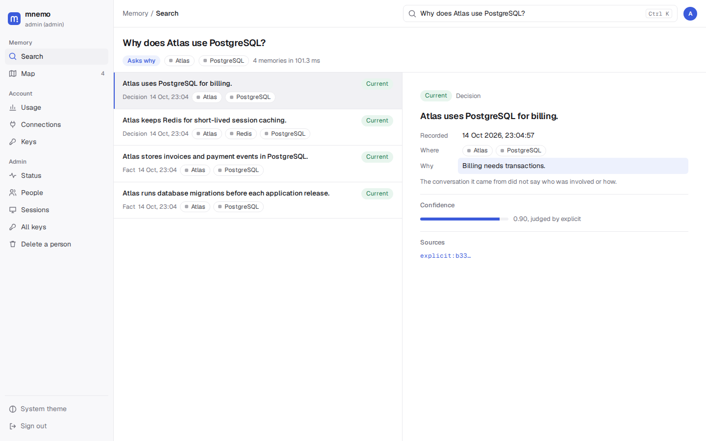

<!--
SPDX-FileCopyrightText: 2026 Mario Campos <https://github.com/mariojcr>
SPDX-License-Identifier: Apache-2.0
-->

# mnemo

**Long-term memory for your AI agents.**

[](https://github.com/mariojcr/mnemo/actions/workflows/build.yml)
[](https://github.com/mariojcr/mnemo/releases)
[](LICENSE)

Stop repeating your project context every session. mnemo remembers conversations, keeps track of
changing facts, and brings relevant context back to **Claude Code, Codex, and other MCP clients**.
Run it on your own infrastructure, with the model provider you choose.

[Quick start](#quick-start) · [Connect your agent](#connect-your-agent) · [Documentation](docs/README.md) · [Releases](https://github.com/mariojcr/mnemo/releases)


*The actual web UI, with fictional project data. Search your memories or explore their connections on the map.*

## Why mnemo?

- **Carry context between sessions and clients.** Hooks store conversation turns and recall relevant
  memories before your agent answers. MCP and HTTP let other tools use the same personal memory.
- **Remember why, not just what.** Memories capture who, when, where, why and how; memories distilled
  from conversations link back to their source episodes.
- **Keep changing facts straight.** A judge checks new information against existing memories. Updates
  close the old memory instead of erasing its history.
- **Keep context useful.** Session budgets and deduplication limit injections; usage evaluation can
  mute memories that repeatedly go unused.
- **Own the deployment.** One Rust binary and ClickHouse, local CPU embeddings, API keys or OIDC.
  Distillation uses an OpenAI-compatible endpoint you configure.

For example: record *“We chose PostgreSQL for Atlas because billing needs transactions.”* In a
later session, ask *“Why does Atlas use PostgreSQL?”* mnemo retrieves the decision and its reason
for the agent. You can try the storage and recall part below without configuring an LLM.

## Quick start

You need **Git, Docker with Compose, curl and OpenSSL**, on **Linux x86_64**. Commands below work
in a POSIX shell. The published image includes the embedding model; allow roughly 1.3 GB for the
mnemo image, plus ClickHouse and your data. Native macOS, Windows and ARM64 binaries are not
published. See [installation and platform support](docs/installation.md).

```sh
git clone https://github.com/mariojcr/mnemo.git
cd mnemo
export MNEMO_ADMIN_KEY=$(openssl rand -hex 24)
docker compose up -d
curl --fail --retry 30 --retry-connrefused --retry-delay 2 http://127.0.0.1:7700/healthz
```

Compose downloads the published release; no Rust compilation is needed. Keep this shell open so
subsequent commands use the same admin key. The server listens only on `127.0.0.1:7700`.

Store a decision:

```sh
curl --fail-with-body -sS http://127.0.0.1:7700/v1/memories \
  -H "Authorization: Bearer $MNEMO_ADMIN_KEY" -H 'Content-Type: application/json' \
  -d '{"scope":"user:admin","kind":"decision","what":"Atlas uses PostgreSQL for billing.","why":"Billing needs transactions.","about":["Atlas","PostgreSQL"]}'
```

Ask for it back:

```sh
curl --fail-with-body -sS http://127.0.0.1:7700/v1/recall \
  -H "Authorization: Bearer $MNEMO_ADMIN_KEY" -H 'Content-Type: application/json' \
  -d '{"query":"Why does Atlas use PostgreSQL?"}'
```

The response includes ranked `items` and a `text` block containing the decision, its reason and a
memory citation. Open **http://127.0.0.1:7700** and sign in with the same admin key to search in the
web UI. `docker compose down` stops the services and keeps their data volumes.

### Turn conversations into memories

Storage and recall work without an LLM. Automatic distillation needs an OpenAI-compatible endpoint
and a model already available there, for example Ollama with `qwen3:14b`:

```sh
export MNEMO_LLM_URL=http://host.docker.internal:11434/v1
export MNEMO_EXTRACT_MODEL=qwen3:14b
docker compose up -d
```

The endpoint must be reachable from the container; a host service bound only to `127.0.0.1` may
need its listen address adjusted. For a hosted provider, set its `/v1` URL and `MNEMO_LLM_KEY`.
mnemo does not start or download your extraction model. [Model configuration](docs/operations.md#models).

## Connect your agent

Create a personal key instead of giving an agent your admin key:

```sh
docker compose exec mnemo mnemo key create --subject ana
```

The key is printed once. It owns a separate memory scope: the admin's quick-start memory will not
appear for `ana`. Install the [signed client binary](docs/installation.md#install-the-client), then
set `MNEMO_URL=http://127.0.0.1:7700` and `MNEMO_KEY=mnemo_…` in `~/.mnemo/config.env`.

### Claude Code

```text
/plugin marketplace add https://github.com/mariojcr/mnemo.git
/plugin install mnemo@mnemo
```

The plugin stores your prompt and final answer, recalls context before each turn, and adds the
`recall`, `remember`, `forget`, `keep` and `recall_episode` tools. It requires `mnemo` on your
`PATH`. [Setup and hook behavior](docs/clients.md#claude-code-plugin).

### Codex

Register `mnemo mcp` and install the hooks from
[`integrations/codex/hooks.json`](integrations/codex/hooks.json).
[Complete setup](docs/clients.md#codex).

### Other MCP and HTTP clients

Connect over HTTP at `/mcp`, or use `mnemo mcp` for stdio. For a client supporting HTTP MCP:

```json
{
  "mcpServers": {
    "mnemo": {
      "type": "http",
      "url": "http://127.0.0.1:7700/mcp",
      "headers": {"Authorization": "Bearer mnemo_…"}
    }
  }
}
```

Remote clients need a server URL they can reach. [MCP tools and HTTP API](docs/clients.md#mcp-tools).

## Data and privacy

Episodes and memories stay in your ClickHouse deployment. Embeddings run locally on the CPU.
When enabled, extraction, judging and usage evaluation send relevant content to the model endpoints
you configure. Recall results become context for the agent and its model provider.

Hooks capture prompts and final answers, which may include sensitive project information. Each
person has their own memory scope; service keys can access the personal scopes they are authorized
to serve. `forget` closes a memory; it does not erase its source episodes.
[Data flow, access and deletion](docs/privacy.md).

## Performance and limits

Recall ranks memories in RAM without a generative LLM call. Semantic recall also computes a local
query embedding. The synthetic in-memory benchmark has measured roughly **8 ms p95 over one
million memories**; this excludes embeddings, HTTP and storage fallback. Typical semantic recall
is documented at **35–50 ms including query embedding**, a different measurement rather than a
latency guarantee. [Benchmark scope and reproduction](docs/recall.md#benchmark-scope).

mnemo is early software. Published builds currently target Linux x86_64, each server keeps its
search index in RAM, and each database has one writer. Distillation quality depends on the model
and should be checked against source episodes. [Architecture](docs/architecture.md) · [Operations](docs/operations.md).

## Contributing

Bug reports, documentation fixes and reproducible examples are welcome. Start with
[CONTRIBUTING.md](CONTRIBUTING.md), or [open an issue](https://github.com/mariojcr/mnemo/issues).
For security concerns, follow [SECURITY.md](SECURITY.md).

Development builds and tests run in containers:

```sh
make test             # fmt, clippy, unit tests and a ClickHouse storage suite
make bench N=1000000
make image           # builds mnemo:local
MNEMO_IMAGE=mnemo:local docker compose up -d
```

## License

[Apache-2.0](LICENSE).
