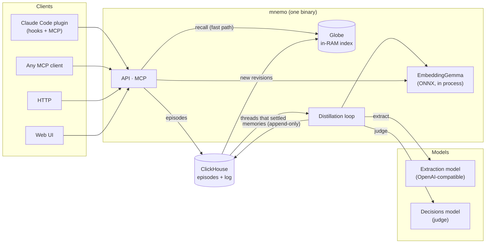

# mnemo documentation

mnemo is long-term memory for agents, models and people. It stores everything it is sent as raw
**episodes**, distills them into **memories** that answer *what, who, when, where, why and how*,
and finds them again in milliseconds, with no LLM call on the fast path.

## Read in this order

| Page | What it explains |
|---|---|
| [Architecture](architecture.md) | The pieces, the processes (`serve`, `api`, `mcp`…) and how they fit |
| [Data model](data-model.md) | Episodes, entities, memories, roles, kinds and a memory's life |
| [Distillation](distillation.md) | From raw episodes to memories: threads, passes, extraction |
| [The judge](judge.md) | How a candidate becomes new, a duplicate, an update or nothing |
| [Recall](recall.md) | How a question is answered in milliseconds, and the scoring |
| [Embeddings](embeddings.md) | EmbeddingGemma inside mnemo: why fp32, limits, re-embedding |
| [Storage](storage.md) | ClickHouse tables, the append-only log and the single writer |
| [Auth and scopes](auth.md) | Who can see what, keys, acting for someone, OIDC and OAuth for MCP, connections |
| [Clients](clients.md) | The Claude Code plugin and its hooks, Codex, MCP tools, the HTTP API |
| [Cost and value](value.md) | Measuring what memory costs and whether it helps |
| [Operations](operations.md) | Running it, configuration, health, metrics and troubleshooting |

## Three ideas behind everything

1. **Keep everything raw, promote carefully.** Episodes are never changed. Memories are a
   *projection* of them that a judge promotes; what the judge rejects is still in the raw store
   and can still be found.
2. **Nothing is overwritten.** Every change to a memory or an entity is a new row with the full
   version. An update *closes* the old memory instead of deleting it, so history is always there.
3. **Models in the background, not in the way.** Extraction and judging run asynchronously.
   Answering a question uses only in-memory structures plus one local embedding (~50 ms).
