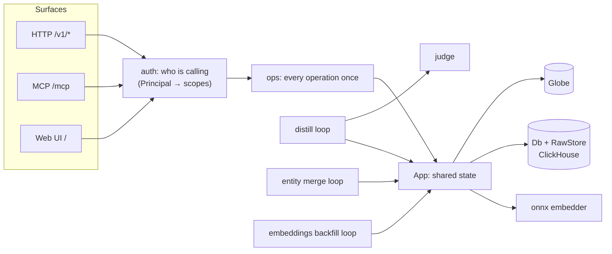
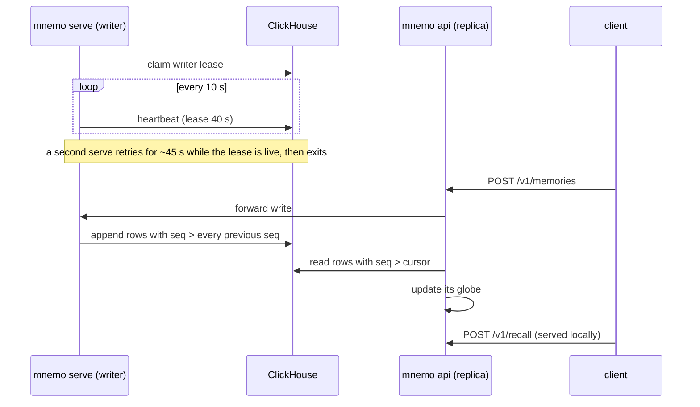
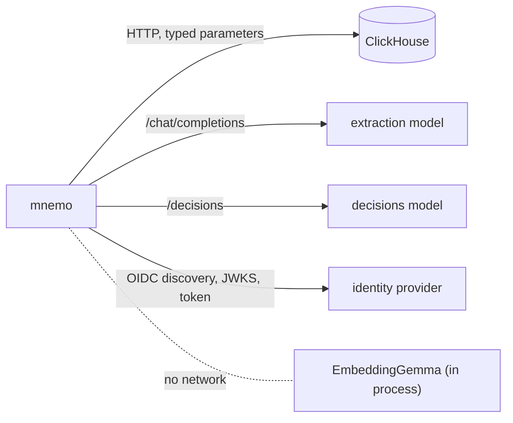

<!--
SPDX-FileCopyrightText: 2026 Mario Campos <https://github.com/mariojcr>
SPDX-License-Identifier: Apache-2.0
-->

# Architecture

## One binary

| Command | What it does |
|---|---|
| `mnemo serve` (default) | The server: HTTP API, MCP, web UI and distillation. The only writer |
| `mnemo api` | A read replica with the same surfaces; forwards writes to `MNEMO_WRITER_URL`, does not distill |
| `mnemo mcp` | Bridges stdio to the server's `/mcp` |
| `mnemo hook <event> [--client claude-code\|codex]` | Claude Code and Codex hooks: `session-start`, `prompt`, `stop` |
| `mnemo login [url]`, `mnemo logout` | OAuth for SSO-only servers |
| `mnemo key create\|list\|revoke` | API keys, written straight to ClickHouse (needs `MNEMO_CH_*`) |
| `mnemo update`, `mnemo version` | Update the binary; print the version and build commit |
| `mnemo health` | Exit 0 if the local server answers `/healthz` (the image's health check) |
| `mnemo bench [n]` | Benchmark recall on a synthetic in-memory index of `n` memories |

`mcp`, `hook` and `login` only talk to the server at `MNEMO_URL`; they start nothing locally.

## Inside a server

- **Surfaces never decide permissions.** HTTP and MCP call the same `ops` functions,
  and the scopes come from the caller's `Principal`, never from the request body.
- **The globe** is an in-RAM projection of the log: an alias automaton over entity names, roaring
  bitmaps per (entity, role), BM25 over what/why/how and int8-quantized vectors. Every server
  builds it at start and reads newer log rows into it every second.
- **Background loops run only on the writer:** distillation, merging duplicate or translated
  entities every 10 minutes, and the embedding backfill (vectors for memories that lack one, or for
  all of them when the embedding model changes).

## Writer and replicas

ClickHouse has no unique constraints or conditional writes, so mnemo has **exactly one writer**.

The writer hands out the sequence, so on a single ClickHouse node a reader that asks for
`seq > cursor` never skips a row; on a replicated one it rereads a window
([storage](storage.md#replicated-clickhouse)). A writer that finds its lease taken by another
exits with code 3.

A replica forwards, with the caller's credentials, every write that needs a sequence number:
`POST /v1/memories`, `/v1/forget`, `/v1/entities`, `/v1/records`, connection changes, re-embedding,
`DELETE /v1/owners/{id}` and the MCP tools `remember`, `forget` and `keep`. The writer authorizes
them again. Episodes and metering rows need no sequence number, so a replica writes them itself.

## What talks to what

The embedding model ships inside the image: mnemo opens no connection for embeddings and never
downloads anything at runtime.

## Source map

| File | Role |
|---|---|
| `main.rs` | subcommands, configuration from the environment, background loops |
| `app.rs` | shared state; recall, remember, distill a thread, merges, backfill |
| `ops.rs` | operations with the caller in front (used by every surface) |
| `api.rs`, `mcp.rs` | the HTTP API and the MCP server |
| `auth.rs`, `oidc.rs`, `login.rs`, `admin.rs` | principals and scopes, web SSO, CLI login, admin panel |
| `model.rs`, `episode.rs` | memories, entities and episodes |
| `globe.rs`, `query.rs`, `text.rs`, `facts.rs` | in-RAM index, question parsing, BM25, hard-fact veto |
| `distill.rs`, `judge.rs`, `llm.rs` | extraction prompt and validation, the judge, the model client |
| `onnx.rs` | the embedder |
| `render.rs`, `galaxy.rs` | JSON and cited text blocks; the map, served as tiles |
| `records.rs` | things with identity over time (alerts, pages, jobs) |
| `meter.rs`, `value.rs` | cost and value |
| `storage/` | `Db`/`RawStore` contracts, ClickHouse, the in-memory double, conformance suite |
| `hook.rs`, `hook/codex.rs`, `client.rs` | Claude Code and Codex hooks and the client they use |
| `update.rs` | `mnemo update` |
