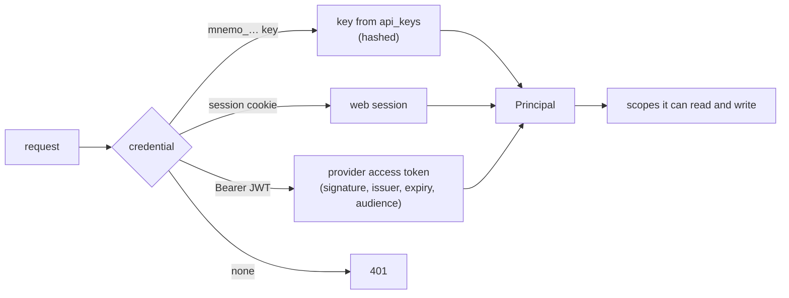
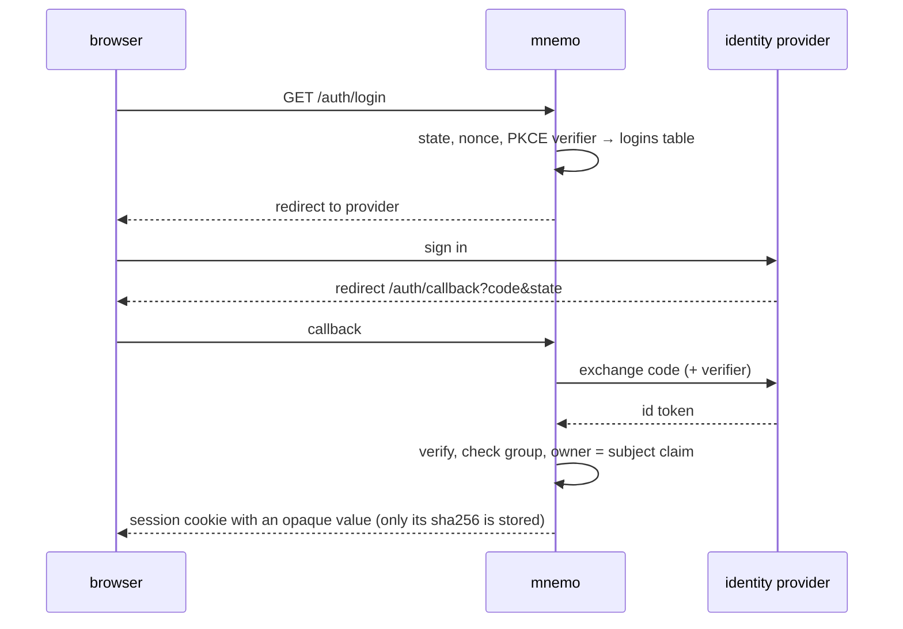
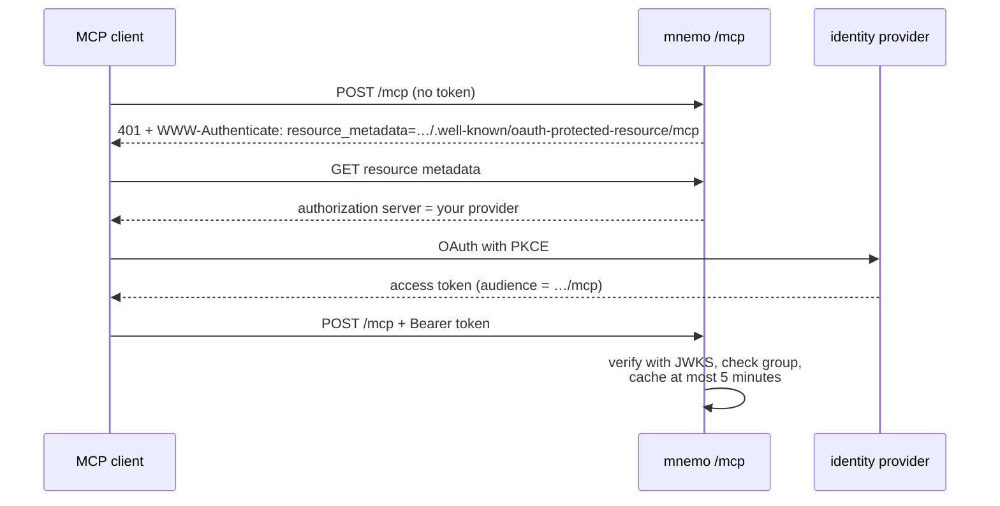
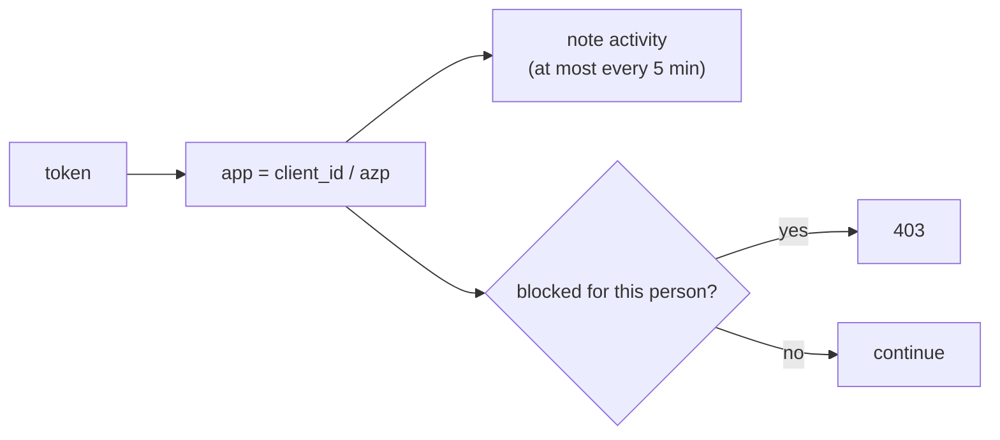

# Auth and scopes

Every memory belongs to one person: its scope is `user:<subject>`. Nothing is global or shared.
Everyone sees and writes only their own memory, admins included.

## Who is calling

| Principal | Sees | Writes |
|---|---|---|
| `user` | `user:<subject>` | `user:<subject>` |
| `service` | the `user:` scopes it passes (a system that already authorizes its users); with `X-Mnemo-Act-As`, the request becomes that person's ([below](#acting-for-someone)) | any `user:` scope |
| `admin` | `user:<subject>`; manages keys, sessions, connections and people ([Admins](#admins)) | `user:<subject>` |

There is no keyless mode: a server with no `MNEMO_ADMIN_KEY`, no keys and no OIDC refuses to start.

## Keys

A key is `mnemo_` plus 64 hex characters, shown once; only its SHA-256 is stored. Servers cache a
key for up to a minute, so a revoked key can keep working that long.

- `mnemo key create --subject <s> [--kind user|service|admin] [--name <n>] [--days <n>]`,
  `mnemo key list`, `mnemo key revoke <id>`. These use ClickHouse directly, so they need the
  server's `MNEMO_CH_*` settings. `--kind` defaults to `user`; without `--days` the key never expires.
- An admin can do the same over HTTP: `POST /v1/keys {name, kind, subject, days?}` (at most 3650
  days), `GET /v1/keys`, `DELETE /v1/keys/{id}`.
- A person signed in to the web can create their own `user` keys under *Keys* (`/v1/me/keys`), only
  from the browser session and for at most 90 days.
- `MNEMO_ADMIN_KEY` is a static admin key with subject `admin`.

## Acting for someone

A `service` key can make a whole request belong to one person with `X-Mnemo-Act-As: <subject>`
(the bare subject, without `user:`). The caller then *is* that person, as a `user`: mnemo answers
with their memory only, whatever scopes the request asks for, and writes only to it.

It is meant for a trusted front end that already signs its people in. It can serve the mnemo web to
them under its own domain (for example at `/mnemo/`, stripping the prefix; the web uses only
relative paths) while mnemo stays on an internal network. The front end only says who the person
is; mnemo decides the scopes.

- **Who can:** only a `service` key (`Authorization: Bearer mnemo_…`). The header with anything else
  (a `user` or admin key, a web session, an OAuth token, no credential) is a `403`, never ignored.
- **Which subject:** exactly one header, non-empty, at most 256 bytes, without `:`, `,`, whitespace
  or control characters; anything else is a `400`.
- **What it reaches:** the memory (recall, the map, memories, episodes, entities, records,
  forgetting, sending episodes). `/v1/keys`, `/v1/me/*`, `/v1/admin/*`, `/v1/owners/*`, `/v1/cost`,
  `/v1/cursors/*`, `/v1/turns` and `/mcp` answer `403`.
- `/v1/whoami` says `"via": "delegated"`, and the web then shows only the map and search: no sign-in,
  sign-out, account or admin.
- **Every delegated response carries `X-Mnemo-Acting-As: <subject>`.** The front end must check it on
  every response and drop any without it or with another subject: a mnemo that ignored
  `X-Mnemo-Act-As` (an older release, or a rollback mid-use) would answer as the `service` key itself,
  which can read any memory.
- A read replica forwards the header with the writes it sends to the writer, so the writer applies
  the same limits.

## Signing in with OIDC

Any OIDC provider works. With OIDC configured, people sign in to the web and MCP clients present the
provider's access tokens, in either auth mode.

| Variable | Default | |
|---|---|---|
| `MNEMO_OIDC_ISSUER` | – | the provider; setting it turns OIDC on |
| `MNEMO_OIDC_CLIENT_ID`, `MNEMO_OIDC_CLIENT_SECRET` | – | the web client; the ID is required, the secret is sent only if set |
| `MNEMO_BASE_URL` | – | required; the redirect URI is `<base>/auth/callback` |
| `MNEMO_OIDC_SCOPES` | `openid email profile` | scopes the web login asks for |
| `MNEMO_OIDC_SUBJECT_CLAIM` | `email` | the owner, lowercased, without `:` or `,`; `email` is accepted only with `email_verified: true` |
| `MNEMO_OIDC_GROUPS_CLAIM` | `groups` | compared lowercased, without a leading `/` |
| `MNEMO_OIDC_ALLOWED_GROUPS` | empty: anyone the provider signs in | checked by mnemo itself, for the web and for tokens |
| `MNEMO_ADMIN_GROUPS`, `MNEMO_ADMIN_EMAILS` | – | who is admin; an email counts only when verified |
| `MNEMO_SESSION_HOURS` | `12` | web session lifetime, 1 to 720 |
| `MNEMO_OAUTH_RESOURCE` | `<base>/mcp` | the resource advertised to MCP clients |
| `MNEMO_OAUTH_AUDIENCES` | the resource | comma-separated `aud` values an access token may carry |

### People in the browser

- The callback is accepted only from the browser that started the login (a `mnemo_login` cookie),
  within 10 minutes.
- The session cookie is `mnemo_session`, with the `__Host-` prefix when `MNEMO_BASE_URL` is https.
  Writes made with it need `X-Mnemo-UI: 1` and, if sent, a same-origin `Origin`.
- Login state and sessions live in the database, so the callback can land on any replica. Signing
  out revokes the session; other replicas may honour their cached copy for up to a minute.

### MCP clients (Claude, Grok…)

- mnemo accepts only access tokens signed with an asymmetric algorithm, from the issuer, unexpired
  and with an accepted audience; an id token is refused. When the token lacks the subject or groups
  claim, mnemo reads them from the provider's userinfo.
- A verified token is cached for at most 5 minutes. Removing someone from the group takes effect
  when their current access token expires (within those 5 minutes if the groups come from userinfo).
- A token is always a `user`, even an admin's. It reaches only memory operations: `/mcp`,
  `/v1/whoami`, recall, memories, forget, episodes, cursors, entities, records, turns, the map, stats
  and cost. Keys, `/v1/me/*`, `/v1/admin/*` and `/v1/owners/*` answer `403`: they need
  the browser session, with the person in front.

### The command line

`mnemo login https://mnemo.example.com` follows the same path as an MCP client, asking for
`openid email profile groups`. It needs a public client (PKCE, no secret) at the provider:

- client ID `mnemo-cli` (`MNEMO_LOGIN_CLIENT_ID`);
- redirect URI `http://127.0.0.1:7787/callback` (port from `MNEMO_LOGIN_PORT`).

The server and the provider must use https (plain http only on loopback), and the server must
advertise its own `/mcp` as the resource. The token is stored in `~/.mnemo/oauth.json`, readable only
by its owner, and refreshed on its own when the provider issues a refresh token. `mnemo logout`
deletes it. With a provider that ignores the RFC 8707 `resource` parameter (Keycloak),
`MNEMO_LOGIN_ISSUERS` pins which providers a login may go to.

## SSO-only mode

`MNEMO_AUTH=sso` (default `keys`) leaves only web sessions and OAuth tokens: no API keys, no
self-service keys and no admin key (`MNEMO_ADMIN_KEY` is ignored with a warning). The server refuses
to start unless OIDC is configured, the subject claim is not `email` (use the provider's immutable
`sub`) and `MNEMO_OIDC_ALLOWED_GROUPS` is set.

## Connected apps

Each OAuth token says which app it belongs to (`client_id` or `azp`). mnemo keeps the list per
person, so one app can be disconnected without touching the others:

People manage their own apps (and their web sessions) in *Connections*; admins can see and block
any person's. A block reaches every replica within a minute.

## Admins

Admins are people signed in to the web who match `MNEMO_ADMIN_GROUPS` or `MNEMO_ADMIN_EMAILS`, plus
`admin` keys and `MNEMO_ADMIN_KEY`. They see the server status (configuration is shown, never
edited), keys, people, sessions and connections; they can block apps, revoke sessions, re-embed
every memory and delete a person (`DELETE /v1/owners/{id}`, which a person can also do for
themselves). They see other people's cost as numbers only.

They do not read anyone else's memory. With `MNEMO_AUTH=sso` no route lets them; with keys, the only
way is to mint a `user` key for that person, and the key list records who minted every key and when
it was last used.
