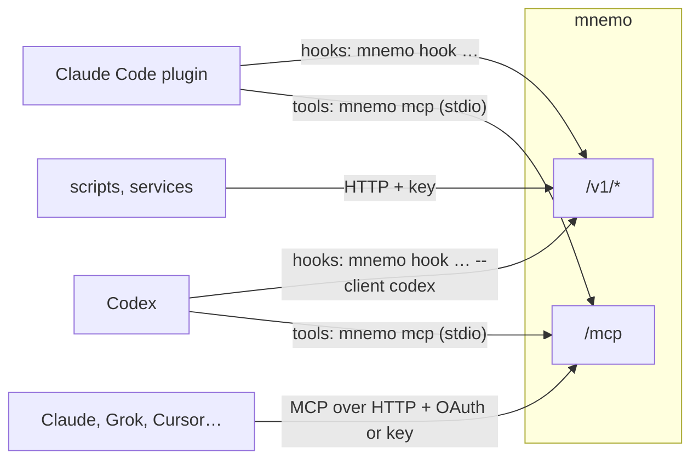
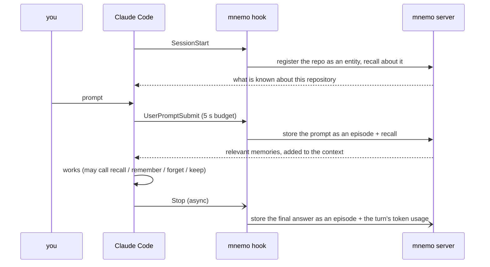
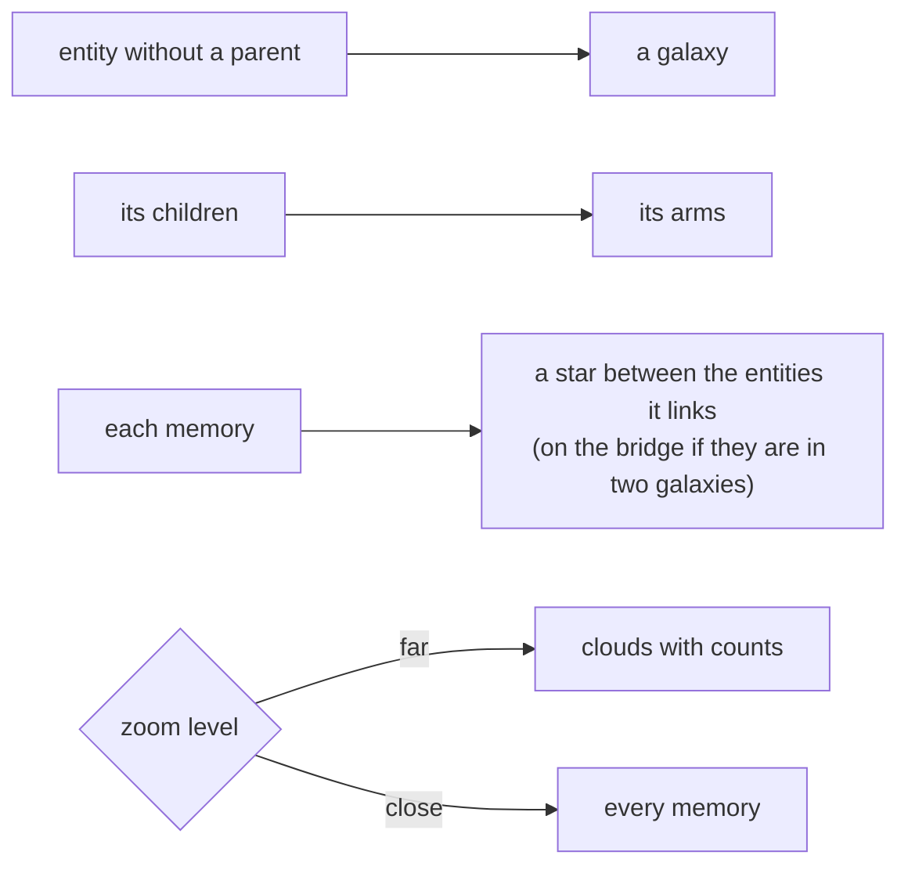

# Clients



## Claude Code plugin

```text
/plugin marketplace add https://github.com/mariojcr/mnemo.git
/plugin install mnemo@mnemo
```

The plugin talks to the server in `MNEMO_URL` and never starts anything locally. Set it in the
environment or in `~/.mnemo/config.env` (only `MNEMO_*` lines are read; the environment wins), and
authenticate with either:

- `MNEMO_KEY=mnemo_…` ([keys](auth.md#keys)), or
- `mnemo login <url>` once, for a server with OIDC ([the command line](auth.md#the-command-line)).
  A key, when set, takes precedence.

Without `MNEMO_URL`, or when the server does not answer its health check, the hooks say so on stderr
and the turn goes on.



The `mnemo` binary is installed apart from the plugin: the plugin's `bin/mnemo` only runs the one
in your `PATH` and never downloads anything. Each release publishes a static Linux x86_64 build;
`mnemo update [version]` downloads it, checks that its manifest `release.txt` is signed by a key in
`deploy/release-key.pub` (built into the binary) and is the build asked for, checks the sum and
replaces itself. From GitHub Releases (`https://github.com/<owner>/<repo>/releases`) it installs the
latest release, or the one given (`v0.2.0`); from a package registry that serves
`<url>/<version>/<file>`, the latest build of main, or the build of a commit (`sha-<7>`). It never
installs a build older than the one it replaces without `--allow-downgrade`. `MNEMO_UPDATE_URL`
points it at another source. At session start the hook
compares its commit with the server's (`/v1/whoami` → `version`) and, when they differ, shows you
a warning (`systemMessage`, which the model does not read).

The repo entity's id comes from `origin`'s `owner/repo` (else the folder name), so every clone is
the same entity. `Stop` also posts the turn's token usage, read from the transcript, to `/v1/turns`.
Hook recalls are lexical only (no embedding, no raw episodes), with a 1.5 s server deadline and a
budget of 900 tokens. What the hooks leave out on purpose:

- The repo is where the session runs, not what it is about. Only the session start asks about it;
  a prompt episode carries the repo's name as `project_id` but is never linked to the repo entity,
  or every memory distilled there would come back on every question asked in that repo.
  Distillation links the repo when the text names it.
- A background task's result reaches Claude Code as if the person had typed it
  (`<task-notification>…`). The hook stores it as role `tool` and searches nothing with it.
- Recalls send the session's `thread` (`cc:<session>`), so memories distilled from this same
  conversation are not injected back while it is still in the context.

Golden rule: **a hook never breaks a turn**. Any failure goes to stderr with exit code 0. If mnemo
does not answer in time, the turn goes on without memory.

## Codex

Codex uses the same binary, configuration and credentials as Claude Code. Its tools go through the
stdio bridge, which authenticates with your key or `mnemo login` token, so Codex needs no OAuth
client of its own at the identity provider.

```sh
codex mcp add mnemo -- /absolute/path/to/mnemo mcp
```

Merge the event groups from [`integrations/codex/hooks.json`](../integrations/codex/hooks.json)
into `~/.codex/hooks.json`, keeping any existing hooks. Replace `mnemo` in the commands with its
absolute path if it is not on Codex's `PATH`. Restart Codex, open `/hooks`, and review and trust
the three mnemo hooks. Codex requires trust again when a hook definition changes.

- The events do what they do for Claude Code. `Stop` is synchronous, with a 10-second limit:
  an async hook can be cancelled when `codex exec` exits.
- `--client codex` labels episodes and turn measurements as `codex`, with `codex:`-prefixed
  sessions and threads. Without it, a hook behaves as Claude Code's.
- Token usage comes from the requested turn in the Codex transcript (deduplicated by response id,
  with cached input and cache writes split from uncached input), or, in older transcripts, from the
  growth of the cumulative count during that turn. The transcript is not a stable Codex interface:
  when usage cannot be read, the answer is still stored and the measurement is skipped rather than
  reported as zero.

See the [Codex hook contract](https://learn.chatgpt.com/docs/hooks) for event fields and tool coverage.

## MCP tools

Served at `POST /mcp` (JSON-RPC; protocol versions 2025-06-18, 2025-03-26 and 2024-11-05; no server
event stream). `mnemo mcp` bridges stdio to the `/mcp` of `MNEMO_URL`.

| Tool | Does |
|---|---|
| `recall` | search memory; returns memories with citations |
| `remember` | store a memory now (judged like any other, but always kept if not a duplicate) |
| `forget` | close a memory that stopped being true |
| `keep` | record an event or snapshot of a thing with a stable key (an alert, a URL, a job) |
| `recall_episode` | read the original episode behind a citation `[e:<id>]` |

Web pages are saved only explicitly, with `keep`; no client captures fetched pages on its own.

## HTTP API

Every route except `/healthz`, the web page and its assets, `/auth/*` and the OAuth resource metadata
needs a credential ([auth](auth.md)).

| Route | Does |
|---|---|
| `POST /v1/recall` | `{query, limit?, scopes?, as_of?, w?, entities?, since?, until?, semantic?, raw?, budget_tokens?, thread?, deadline_ms?}` |
| `POST /v1/memories`, `GET /v1/memories/{id}` | store a memory explicitly; read one with its history |
| `POST /v1/forget` | `{id, reason}`: close a memory |
| `POST /v1/episodes`, `GET /v1/episodes/{id}?around=` | ingest raw episodes; read one with its neighbours |
| `POST /v1/entities`, `GET /v1/entities/{id}` | deterministic entities; an entity's card and timeline |
| `POST /v1/records`, `GET /v1/records?key=` | events and snapshots of things |
| `POST /v1/turns` | a turn's token usage |
| `GET /v1/globe`, `GET /v1/galaxy?z&x&y` | everything visible; a tile of the map |
| `GET /v1/stats`, `GET /v1/whoami`, `GET /v1/cost` | counts, who you are, cost and value |
| `GET /v1/cursors/{name}` | how far a source has sent |
| `/v1/keys` | keys (admin) |
| `/v1/me/keys`, `/v1/me/connections`, `DELETE /v1/me/sessions/{id}` | your keys, apps and sessions |
| `/v1/admin/*` | overview, people, sessions, connections, re-embedding |
| `DELETE /v1/owners/{id}` | delete everything of a person, raw episodes included (that person, an admin or a service) |
| `/healthz` | liveness |

## The map

The web UI's map is served as tiles, like a street map:



Positions come from a hash of the id, so a point never moves when others arrive. Memories are
sorted by their Z-order (Morton) code, so a tile is a contiguous range of the index. Stars are
coloured by memory kind (fact, event, decision…), entities by a hash of their name.
