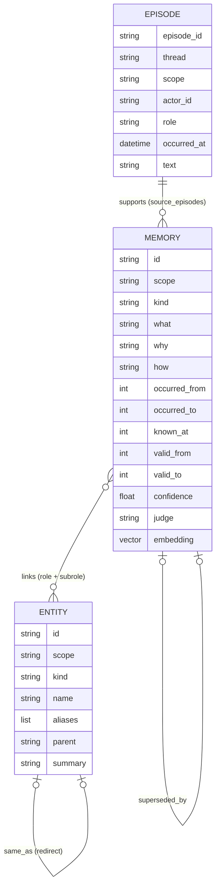
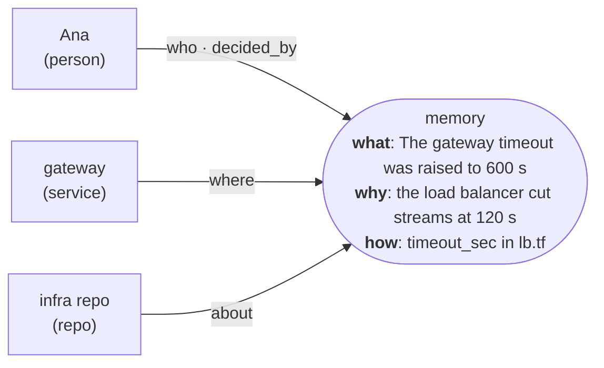
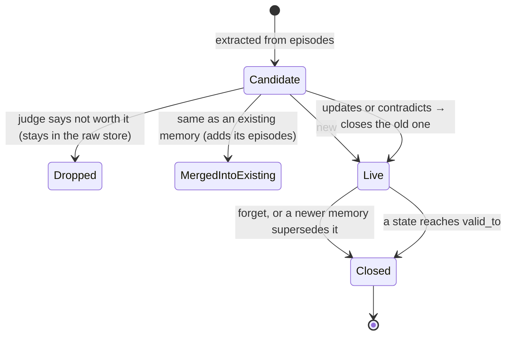

<!--
SPDX-FileCopyrightText: 2026 Mario Campos <https://github.com/mariojcr>
SPDX-License-Identifier: Apache-2.0
-->

# Data model

## Episodes: the raw store

An episode is one message, tool result, workflow step or anything a client wants remembered. It
is **immutable** and keeps its provenance (who, where, when, which thread). Long texts are split
into chunks of at most 6,000 characters (`id#0`, `id#1`…), cut at a line break when there is one.

## Memories: six W's on a hyperedge

A memory joins several entities, each with a role:

| W | Stored as |
|---|---|
| what, why, how | text, always in English (a model reads it) |
| who | links with role `who` and a subrole (`actor`, `affected`, `owner`, `decided_by`); only people, teams and named bots |
| where | links with role `where` (system, environment, repo, file, channel, project) or `about` (what it is about) |
| when | `occurred_from` / `occurred_to`; `known_at` is when mnemo learned it; `valid_from` / `valid_to` is when it holds |

| Kind | Meaning |
|---|---|
| `fact` | true now |
| `event` | something that happened, at a time |
| `state` | true now but transient: an outage, a known problem not fixed yet |
| `decision` | a choice a person made or approved, with its reason |
| `preference` | how someone likes things done |
| `procedure` | how to do something |

## A memory's life

Closing sets `valid_to` (and `superseded_by` when another memory replaced it). A state ends at the
`valid_until` the extraction found or, without one, 7 days after it started. Rows are never
deleted, except when [a person is deleted](storage.md#deleting-a-person): recall can still show
history when the question asks for it, and the UI shows the chain.

## Entities: identity is the name

- One entity per name in each person's scope: "mnemo" the repo and "mnemo" the system are the same
  thing for the person who uses them. A second entity with the same name becomes a redirect
  (`same_as`) to the one with more memories. People are never merged by name.
- Names in two languages ("juez" and "Judge") are merged too: see
  [the judge](judge.md#entities-named-in-two-languages).
- `parent` gives containment: a file is inside a repo, a repo inside a system. Recall uses it to
  match a question about a system with memories about its parts.
- A person's own entity is `person:@user:`, with their subject and email as aliases, so
  the extractor names them instead of inventing a name.

## Scope

Everything belongs to one person: `user:<subject>`. Nothing is global or shared. See
[auth](auth.md).
