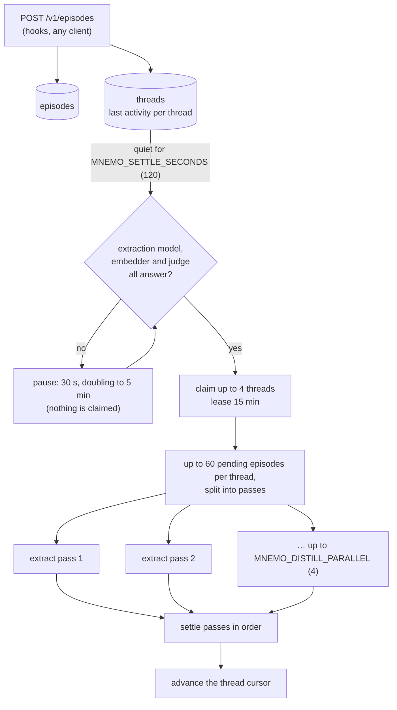
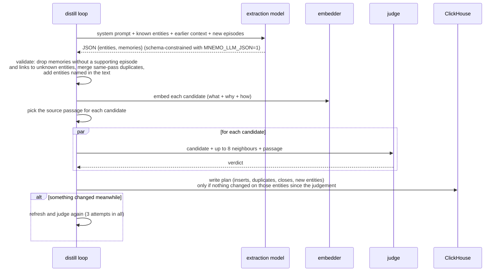
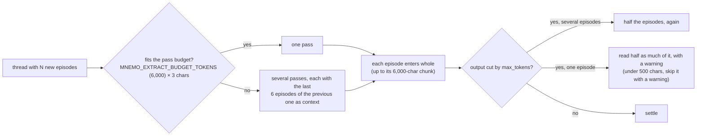

# Distillation

From raw episodes to memories, in the background, on the writer only.

## A pass

## How much goes into a pass

The pass budget is also capped by what fits in `MNEMO_LLM_CONTEXT` (16,384 tokens) next to the
system prompt and the output, which is capped at min(3,000, context/4) tokens. Each call times out
after `MNEMO_LLM_TIMEOUT` (600 s).

The cursor only advances over what was actually settled, so a failure never leaves a gap.

## What the extraction prompt asks for

- Only what helps a **future, different** conversation: facts, decisions and their reasons,
  causes and fixes, procedures, preferences. No chit-chat, no progress snapshots ("tests are
  green", "52 memories").
- `why` and `how` only when the transcript says them. Never invented.
- `who` only for people, teams or named bots.
- Each line says who speaks, and only a person's own lines carry their name: `user <name>`,
  `assistant`, `tool` (a background task or a subagent report; a `<task-notification>` sent as a
  user prompt is shown as `tool`). Clients stamp the person on the whole session, so the name is
  kept off the lines that are not theirs.
- A **proposal is not a decision** until a person accepts it or it is applied. What an assistant
  or a tool line concludes is a fact or a state, never a person's decision. This is also enforced
  after the model: a `decision` that no line of a person supports becomes a `fact`, and loses its
  `decided_by` people.
- **Dropping** a plan ("not worth it", "let's leave it") is stored as a decision that names the
  plan, so the earlier plan can be closed.
- No **work log**: a pushed commit, a deploy or an edited file is not a memory unless it leaves a
  behaviour, a cause, a procedure or a constraint that later work needs.
- A fix is written as its own event naming the same thing, so the old problem can be closed.
- Reuse known entities, also when the transcript names one in another language. New entities get
  English names, with the transcript's term as an alias.
- Text in English.

## Failure behaviour

| Situation | What happens |
|---|---|
| A backend is down | Nothing is claimed; the loop waits (30 s, doubling to 5 min) and logs which backend |
| A pass fails | Passes before it stay settled; the thread is retried, at the latest when its 15-minute lease ends (no retry storms) |
| A write conflicts | The pass refreshes and judges again, 3 attempts in all |
| Output overflows on one episode | It is read in halves, with a warning; under 500 characters it is skipped with a warning |
