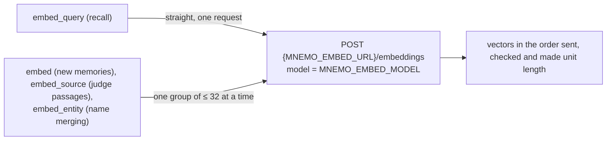
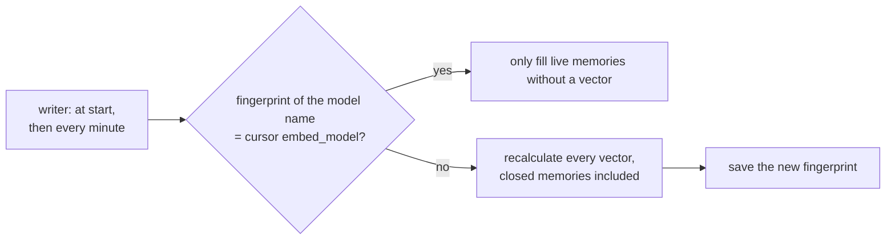

<!--
SPDX-FileCopyrightText: 2026 Mario Campos <https://github.com/mariojcr>
SPDX-License-Identifier: Apache-2.0
-->

# Embeddings

mnemo gets every vector from **EmbeddingGemma 2** (`google/embeddinggemma-2`, 768 dimensions)
behind an OpenAI-compatible `/embeddings` endpoint: in practice the inference gateway, which serves
it with vLLM. The image carries no model and no inference runtime.

- `MNEMO_EMBED_MODEL` turns it on (for example `altherium/embeddinggemma-2`). The endpoint and key
  are `MNEMO_EMBED_URL` and `MNEMO_EMBED_KEY`, by default the extraction model's
  (`MNEMO_LLM_URL`, `MNEMO_LLM_KEY`). Without a model, or with `MNEMO_EMBED=off`, there are no
  vectors: no search by meaning, judge passages picked by word overlap, no merging of translated
  entity names.
- Prompts: `task: search result | query: ` for questions, `title: none | text: ` for what is stored,
  sent as part of the text (EmbeddingGemma's retrieval prompts).
- An answer with fewer or more vectors than texts, a repeated index, an empty or zero vector or
  vectors of different sizes is an error: a memory stored with the wrong vector could never be
  found again. A pass that cannot get its vectors waits and retries.
- Served with vLLM, text only: `vllm serve google/embeddinggemma-2 --runner pooling
  --limit-mm-per-prompt image=0,audio=0,video=0` loads the 271M-parameter text model (~0.5 GB of
  GPU memory). The vision and audio towers are not needed for memories.

## Limits

| Setting | Value | Why |
|---|---|---|
| text length | 8,000 characters (longer texts are cut) | memories are a few hundred tokens and a judge passage 1,500 characters; a longer text would only tie up the model |
| query length | 2,000 characters | a search never needs more |
| background groups | 32 texts per request, one request at a time | a search never waits behind a batch: it goes straight to the endpoint |
| deadlines | the caller's | waiting work is abandoned at its deadline, not queued |

## When the model changes

Vectors from different models are not comparable (two deployments of the same model gave cosine
−0.02 for the same text), and a foreign vector silently hides its memory from search. Admin →
Status → *Recalculate all vectors* (`POST /v1/admin/reembed`) forces a full recalculation.

## Metering

Every request is recorded in `llm_calls` with kind `embed`, `embed_query`, `embed_source` or
`embed_entity`, the endpoint's token count and how long the request took.
