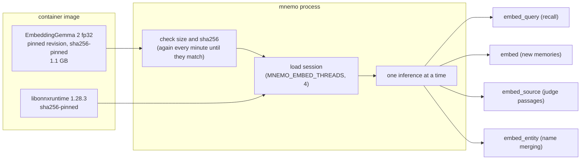
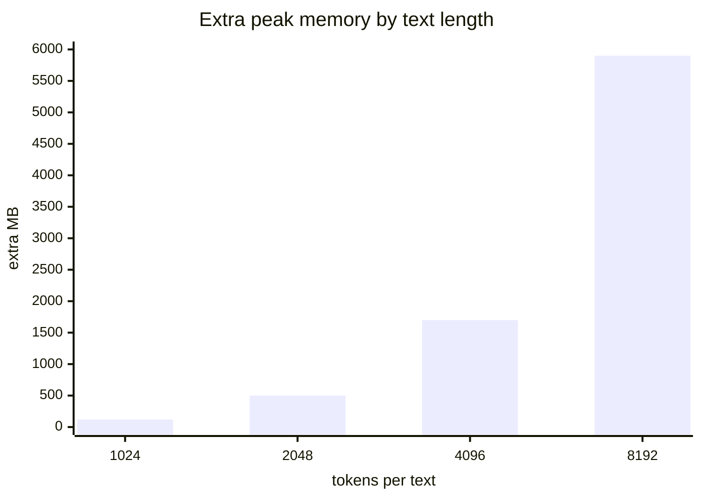
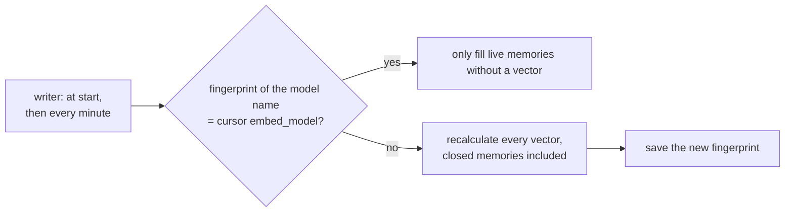

# Embeddings

mnemo computes every vector itself, with **EmbeddingGemma 2** in fp32 on ONNX Runtime, on the
CPU. There is no embedding service and no other embedding model.

- The image carries the model. mnemo **never downloads** it: it reads `MNEMO_EMBED_DIR` (outside
  the image, `$MNEMO_HOME/models/embeddinggemma-2`) and the library at `ORT_DYLIB_PATH`. While the
  files are missing or do not match, the embedder reports why and distillation waits.
- Prompts: `task: search result | query: ` for questions, `title: none | text: ` for what is stored.
- 768 dimensions, normalized. The globe keeps them quantized to int8.
- `MNEMO_EMBED=off` runs without vectors: no search by meaning, judge passages picked by word
  overlap, no merging of translated entity names.

## Why fp32

Measured on an 8-core laptop CPU (i7-11800H, 4 threads), warm, median of 5:

| Build | 16 tokens | 53 tokens (a typical memory) | 132 tokens | 2,048 tokens | RAM loaded |
|---|---|---|---|---|---|
| **fp32** | 29 ms | **50 ms** | 111 ms | 4.1 s | 684 MB |
| int8 | 82 ms | 113 ms | 178 ms | 4.3 s | 457 MB |
| q4 | 24 ms | 52 ms | 127 ms | 4.4 s | 404 MB |

The int8 build uses dynamic quantization: it quantizes activations on every call, which costs
more than it saves on short texts. Vectors barely change between fp32 and int8 (mean cosine
0.9999); q4 drifts more (0.985). Going from 4 to 8 threads gains about 10 %.

## Limits

Cost grows with the square of the length:

| Setting | Default | Why |
|---|---|---|
| `MNEMO_EMBED_MAX_TOKENS` | 2,048 (longer texts are truncated) | a native 8K text needs ~6 GB and 14 s; real memories are at most ~200 tokens (median 53) |
| batch size | ≤ 8,192 positions per call | a huge query or many long texts cannot exhaust memory |
| query length | 2,000 characters | a search never needs more |
| concurrency | one inference at a time | waiting work is abandoned at its deadline, not queued |

## When the model changes

Vectors from different models are not comparable (two deployments of the same model gave cosine
−0.02 for the same text), and a foreign vector silently hides its memory from search. Admin →
Status → *Recalculate all vectors* (`POST /v1/admin/reembed`) forces a full recalculation.

## Metering

Every inference is recorded in `llm_calls` with kind `embed`, `embed_query`, `embed_source` or
`embed_entity`, its token count and how long the inference took (not the wait for a turn).
