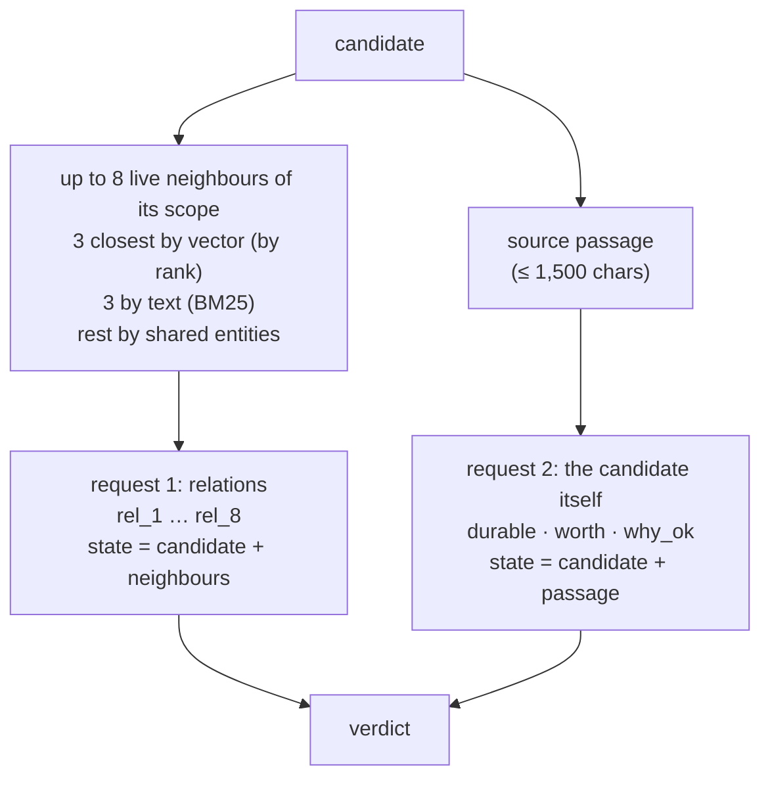
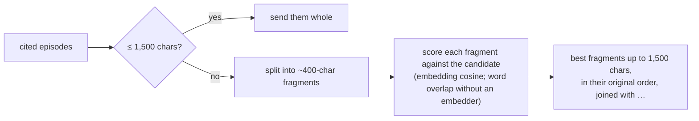
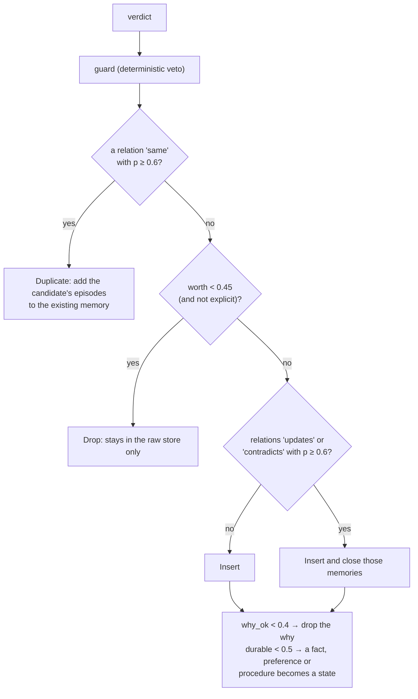
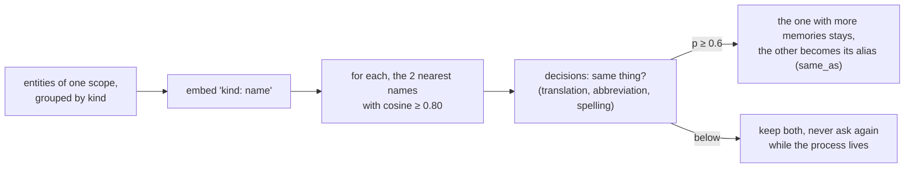

<!--
SPDX-FileCopyrightText: 2026 Mario Campos <https://github.com/mariojcr>
SPDX-License-Identifier: Apache-2.0
-->

# The judge

The judge decides what each candidate memory is, next to the memories that already exist. It
decides what gets **promoted**, never what gets kept: everything stays in the raw store.

## Which judge

| `MNEMO_JUDGE` | Judge |
|---|---|
| `auto` (default) | the decisions model if `MNEMO_DECIDE_MODEL` is set, else the extraction model if `MNEMO_EXTRACT_MODEL` is set, else the heuristic |
| `decisions` | the decisions model, else the heuristic |
| `llm` | the extraction model (one JSON answer with confidences), else the heuristic |
| `heuristic` | no model: a duplicate only when the candidate adds no word to an existing memory and no hard fact differs; nothing is closed |

The decisions model is any service that answers `POST {MNEMO_DECIDE_URL}/decisions`
(`{model, state, questions}` → `{answers}`) with typed answers and calibrated probabilities.
`MNEMO_DECIDE_URL` and `MNEMO_DECIDE_KEY` default to the extraction endpoint. Every judge call
times out after `MNEMO_JUDGE_TIMEOUT` (180 s).

In the background a judge that does not answer fails the pass, and distillation pauses until it
answers; a heuristic verdict is never written silently in its place. The heuristic answers instead
only for an explicit `remember` (someone is waiting) and when an LLM judge returns invalid JSON
(with a warning).

## The questions

A decisions service evaluates every question against the whole state, so the two requests carry
only what their questions need: relations compare memories and do not need the source; durable,
worth and why_ok look at the candidate and its source, not at the neighbours. The LLM judge gets
everything in one call.

| Question | Type | Asks |
|---|---|---|
| `rel_n` | choice | same · updates · contradicts · different, against neighbour *n* |
| `durable` | yes/no | still true one month after it was recorded? |
| `worth` | yes/no | would it help a different, future conversation? (not asked for an explicit `remember`) |
| `why_ok` | yes/no | does the source support the `why`? (only when there is a why and a source) |

## The source passage

In a long episode (a subagent's report, a pasted log) the sentence that supports the `why` is often
far from the start, so the judge sees the part that matters:

Fragments are scored by embedding because memories are in English and transcripts may not be. On
the 21 longest episodes of a real deployment, a judge shown the first 2,000 characters rejected
**25 of 42** reasons; shown the passage, **1**.

## From verdict to outcome

A relation below 0.6 merges and closes nothing: in doubt, both memories are kept. A state with no
known end is given one 7 days after it starts. The stored confidence is the `worth` probability
with the decisions judge, otherwise 0.6 (0.9 for an explicit `remember`).

### The guard

Any judge, model or not, is overruled when hard facts differ:

| Case | Overruled to |
|---|---|
| two events more than 2 minutes apart called "same" | different (the alert fired again) |
| "same" but numbers, ids, versions, negations or polarity differ (`facts.rs`) | updates, with p capped at 0.5 |

A vector says two texts are about the same thing, not that they say the same thing: "the LB cuts
at 120 s" and "at 600 s" score 0.947. Used alone as a judge, cosine similarity got 64 % of
labelled relations right, below the 76 % of always answering "different".

The guard compares words with a digit or an inner sign (`0.30.0-2`, `user:ana`, `api-v2`, URLs),
negations (English and Spanish) and opposite pairs (enabled/disabled, up/down, …). A number keeps
its unit, written one way: "30 seconds" and "30s", or "400-day" and "400 days", are the same fact,
while "120 s" and "120 ms" are not. Words joined only by hyphens or underscores
("decision-making", "prod-eu") separate two memories only when each side has its own ("prod-eu"
against "prod-us"), not when a paraphrase leaves one out: counted as ids, they vetoed rewordings
the judge had right.

## Entities named in two languages

The extractor names what it hears, so a conversation in Spanish and another in English could split
one thing into two entities ("juez" and "Judge"). Every 10 minutes the writer merges entities with
the same name in a scope and then, with the decisions judge, translated names:

The vector alone cannot decide: "firewall" is closer to "reverse proxy" (0.875) than to
"cortafuegos" (0.870), and "mnemo" to "mnemo login" (0.94). With the judge, 287 of 287 test pairs
were right (same pairs 0.72–0.92, different ones at most 0.38).

Bounds: groups over 500 entities are skipped, at most 50 questions per pass, people are never
merged, and nothing crosses from one scope to another.
