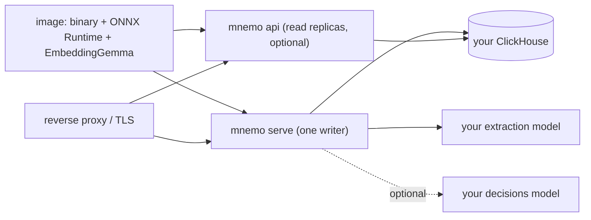

# Operations

## Run it

mnemo brings no infrastructure: you provide ClickHouse and, for distillation, an OpenAI-compatible
model. The image carries the binary, ONNX Runtime and the embedding model.



To try it on your machine, `compose.yaml` at the repository root starts ClickHouse and one server on
`127.0.0.1:7700`. Against your own ClickHouse:

```sh
make image   # builds mnemo:local
docker run -p 7700:7700 \
  -e MNEMO_CH_URL=http://clickhouse:8123 -e MNEMO_CH_USER=mnemo -e MNEMO_CH_PASSWORD=… \
  -e MNEMO_LLM_URL=http://llm:8000/v1 -e MNEMO_EXTRACT_MODEL=… \
  -e MNEMO_ADMIN_KEY=… \
  mnemo:local serve
```

- **ClickHouse user.** mnemo creates its database and tables at start, so its user needs every
  right on that database (`GRANT ALL ON mnemo.* TO mnemo`). On a replicated ClickHouse you create
  the database yourself: see [storage](storage.md#replicated-clickhouse).
- **No keyless mode.** The server needs `MNEMO_ADMIN_KEY`, a key (`mnemo key create --subject
  <you>`, run with the same `MNEMO_CH_*`) or OIDC, and refuses to start without any of them.
- **No state on disk.** Everything is in ClickHouse. Only one `serve` runs per database: after a
  clean shutdown a new one takes the lease at once, after a crash within ~45 s. Scale reads with
  `mnemo api` and `MNEMO_WRITER_URL` pointing at the writer.

## Releases

`.github/workflows/build.yml` runs `make test`, ClickHouse included, on every push and pull request.
From main it pushes the image to `ghcr.io/mariojcr/mnemo` as `main` and `sha-<7>`. To release, tag a
commit on main and push the tag:

```sh
git tag v0.2.0 && git push origin v0.2.0
```

A version tag also pushes the image as `0.2.0` and `latest` (not for a pre-release such as
`v0.2.0-rc.1`) and publishes a GitHub Release with the static client for Linux x86_64, its
`checksums.txt` and the signed manifest that `mnemo update` installs. Every build carries its
commit: `mnemo version` and `/v1/whoami` show it.

The manifest `release.txt` holds the binary's sum plus `commit`, `ref` and `seq`, a build number that
only grows on main and that no committer chooses: the count of first-parent commits up to the tag,
plus 100 (builds made before this repository existed are numbered below that). It is signed with
the Ed25519 key in the secret `RELEASE_SIGNING_KEY` (`release.txt.sig`, base64), so a binary that
`mnemo update` accepts takes the key, not just access to the release files, and another signed
build cannot be served in place of the one asked for. The workflow signs in its own job, on a fresh
runner where nothing built runs, with the key on stdin; it refuses a key whose public half is not in
`deploy/release-key.pub` and verifies the signature before publishing.

Anyone who can change a workflow can read a secret, so the key's protection is the repository's:

- keep the secret in a `release` environment whose deployment rule allows only `v*` tags (optionally
  with a required reviewer), not among the repository secrets;
- restrict who can create, move or delete `v*` tags with a tag ruleset;
- keep a copy of the private key outside GitHub: a secret cannot be read back.

To rotate the key: append the new public key to `deploy/release-key.pub` and release (still signed
with the old one), so that installed binaries learn it; then put the new key in the secret, and
remove the old one from the file once no older binary is in use.

## The image

| Layer | Content | Pinned by |
|---|---|---|
| base | debian trixie-slim | digest |
| runtime | `libonnxruntime.so.1.28.3` | sha256 of the official release |
| model | EmbeddingGemma 2 fp32 + tokenizer (1.1 GB) | revision + sha256 per file |
| app | the `mnemo` binary | built in the `build` stage, from `Cargo.lock` |

`make image` builds the `runtime` stage of the `Dockerfile`. The model layer sits before the binary,
so it is reused between builds. The image (~1.25 GB) runs as user `mnemo` with `MNEMO_HOME=/data`,
listens on `0.0.0.0:7700` and checks itself with `mnemo health`.

## Configuration

Everything comes from the environment or from `$MNEMO_HOME/config.env` (only `MNEMO_*` variables;
the environment wins). Admin → Status shows the configuration; nothing is edited there.

### Storage and serving

| Variable | Default | |
|---|---|---|
| `MNEMO_CH_URL`, `MNEMO_CH_USER`, `MNEMO_CH_PASSWORD`, `MNEMO_CH_DB` | required, `mnemo`, empty, `mnemo` | your ClickHouse (HTTP interface) |
| `MNEMO_CH_WAIT_SECONDS` | 30 | how long to wait for ClickHouse at start |
| `MNEMO_CH_REPLICATED` | off | `1` on a replicated ClickHouse: refuse to start unless the database already exists as `Replicated` (see [storage](storage.md#replicated-clickhouse)) |
| `MNEMO_LISTEN` | `127.0.0.1:7700` (`0.0.0.0:7700` in the image) | address to serve on |
| `MNEMO_FORWARDED_HOPS` | 1 | trusted reverse proxies in front, for the per-client login limit: the client is that many entries from the end of `X-Forwarded-For`; only read when the socket peer is loopback, private or link-local; `0` ignores the header |
| `MNEMO_HOME` | `~/.mnemo` (`/data` in the image) | `config.env` and the token of `mnemo login` |
| `MNEMO_WRITER_URL` | – | required by `mnemo api`: the writer to forward writes to |
| `MNEMO_BASE_URL` | – | public URL: OIDC redirect (`/auth/callback`), default OAuth resource; with `https://` the cookies are `Secure` and `__Host-` prefixed |

### Models

| Variable | Default | |
|---|---|---|
| `MNEMO_LLM_URL`, `MNEMO_LLM_KEY` | – | OpenAI-compatible root (`…/v1`) for extraction |
| `MNEMO_EXTRACT_MODEL` | – | without it nothing is distilled (everything is still stored and searchable) |
| `MNEMO_LLM_JSON` | off | `1` asks for schema-constrained JSON |
| `MNEMO_LLM_THINKING` | on | `off` stops a reasoning model from thinking first |
| `MNEMO_LLM_CONTEXT`, `MNEMO_LLM_TIMEOUT` | 16384, 600 s | model window and per-call limit |
| `MNEMO_DECIDE_URL`, `MNEMO_DECIDE_KEY` | `MNEMO_LLM_URL`, `MNEMO_LLM_KEY` | the decisions service the judge calls (`POST /decisions`) |
| `MNEMO_DECIDE_MODEL` | – | without it there is no decisions judge |
| `MNEMO_JUDGE`, `MNEMO_JUDGE_TIMEOUT` | `auto`, 180 s | `auto`, `decisions`, `llm` or `heuristic` ([the judge](judge.md#which-judge)), and its limit per verdict |
| `MNEMO_EMBED` | on | `off` disables semantic search |
| `MNEMO_EMBED_DIR` | the image's model | EmbeddingGemma's files; outside the image `$MNEMO_HOME/models/embeddinggemma-2` (`./models/…` if `MNEMO_HOME` is unset) |
| `ORT_DYLIB_PATH` | `libonnxruntime.so` (set in the image) | the ONNX Runtime library |
| `MNEMO_EMBED_THREADS`, `MNEMO_EMBED_MAX_TOKENS` | 4, 2048 | embedder bounds |

### Distillation and value

| Variable | Default | |
|---|---|---|
| `MNEMO_SETTLE_SECONDS` | 120 | a thread is distilled after this long quiet |
| `MNEMO_EXTRACT_BUDGET_TOKENS` | 6000 | prompt tokens per extraction pass |
| `MNEMO_DISTILL_PARALLEL` | 4 | passes of one thread in flight at once; up to 4 threads are distilled together, so the model sees up to 4× this many requests |
| `MNEMO_SESSION_BUDGET_TOKENS` | 4000 | automatic injection per session; `0` = no limit |
| `MNEMO_MUTE_AFTER` | 6 | a memory judged this many times and never used is no longer injected automatically; `0` = never |
| `MNEMO_EVAL_SAMPLE` | 0.25 | fraction of turns the LLM judges for use when there is no decisions service |
| `MNEMO_PRICES` | – | `model=input,cache_read,cache_write,output;…` in dollars per million tokens, for the cost report |

### Auth

| Variable | Default | |
|---|---|---|
| `MNEMO_AUTH` | `keys` | `sso` leaves only SSO sessions and OAuth tokens ([SSO-only mode](auth.md#sso-only-mode)) |
| `MNEMO_ADMIN_KEY` | – | a static admin key (ignored with `MNEMO_AUTH=sso`) |
| `MNEMO_OIDC_*`, `MNEMO_ADMIN_GROUPS`, `MNEMO_ADMIN_EMAILS`, `MNEMO_SESSION_HOURS`, `MNEMO_OAUTH_*` | | sign-in with OIDC: [the list, with defaults](auth.md#signing-in-with-oidc) |

### Clients

| Variable | Default | |
|---|---|---|
| `MNEMO_URL`, `MNEMO_KEY` | – | the server the plugin, `mnemo mcp` and hooks talk to; without a key, the token of `mnemo login` |
| `MNEMO_LOGIN_CLIENT_ID`, `MNEMO_LOGIN_PORT`, `MNEMO_LOGIN_ISSUERS` | `mnemo-cli`, 7787, any | `mnemo login`: the public client at the provider, its loopback port, the providers it trusts |

## Health

`GET /healthz` answers without credentials. Logs go to stderr (`RUST_LOG` sets the level, `info` by
default). Each pass logs one JSON line (`kind: distill`) with episodes, candidates, inserted,
duplicates, closed, new entities and milliseconds; each recall one (`kind: recall`) with hits,
tokens, latency and whether semantic search ran.

When a backend does not answer, the writer pauses distillation, retries from every 30 s up to every
5 minutes, and logs `distillation paused: <backend> is not responding (<error>)`; then
`distillation resumed: every backend responds`. The web UI shows *Distillation paused*. Episodes are
still stored meanwhile.

| `<backend>` | Check |
|---|---|
| `the extraction model` | `MNEMO_LLM_URL`, `MNEMO_LLM_KEY`, network: mnemo probes `<url>/models`, then `/health` at the root |
| `the judge` | `MNEMO_DECIDE_URL` (the same probe), or the extraction model when it judges |
| `the embedder` | still loading at start, or its files are missing or unreadable: `MNEMO_EMBED_DIR`, `ORT_DYLIB_PATH` |

## Metrics in ClickHouse

Calls per job in the last day, with latency and tokens:

```sql
SELECT kind, model, count() AS n,
       quantile(0.5)(ms) AS p50_ms, quantile(0.95)(ms) AS p95_ms,
       avg(prompt_tokens) AS tokens_in, countIf(ok = 0) AS failed
FROM llm_calls
WHERE at > toUnixTimestamp64Milli(now64() - INTERVAL 1 DAY)
GROUP BY kind, model
ORDER BY n DESC
```

Threads with episodes not distilled yet:

```sql
SELECT count() AS pending_threads
FROM (SELECT thread, last_ms FROM threads FINAL) AS t
LEFT JOIN (SELECT thread, upto_ms FROM progress FINAL) AS p USING thread
WHERE t.last_ms > p.upto_ms
```

## Troubleshooting

| Symptom | Look at |
|---|---|
| nothing new is remembered | `MNEMO_EXTRACT_MODEL` set? distillation paused ([Health](#health))? |
| a second `serve` exits with `another writer (…) is already active on this database` | another writer holds the lease; run `mnemo api` for more capacity |
| `serve` exits with code 3, `another writer has taken over the lease on this database` | it stalled past its lease and another `serve` took over: run one `serve` per database |
| `serve` exits with `the ClickHouse replica answering is lagging on the log or the writer lease` | replicated ClickHouse: the replica it reaches has `log` or `writer` parts to fetch from another one, or lost Keeper; check `system.replication_queue` and `system.replicas` there, and that the other replica is up |
| `MNEMO_CH_REPLICATED: database … does not exist` (or `…, not Replicated`) at start | create the database as `Replicated` on every replica |
| search finds nothing by meaning | the `recall` log line has `"semantic": false`: the embedder is not ready or too slow |
| vectors look wrong | Admin → Status → Recalculate all vectors (a model change recalculates them on its own) |
| an app gets 403 `this app was disconnected from your mnemo` | it was disconnected under *Connections*; allow it again there |
| the same thing appears as two entities | wait for the next merge pass (every 10 minutes) |

## Development

Everything builds and runs in a container; no Rust needed on the host.

```sh
make test             # fmt, clippy, unit tests, storage suite against a throwaway ClickHouse
make test-replicated  # the storage suite and the replica tests against two replicas and a Keeper
make integration      # service tests against a running server (MNEMO_TEST_URL, MNEMO_TEST_KEY)
make bench N=1000000
make image            # runtime image
make release          # static Linux binary in dist/
```
