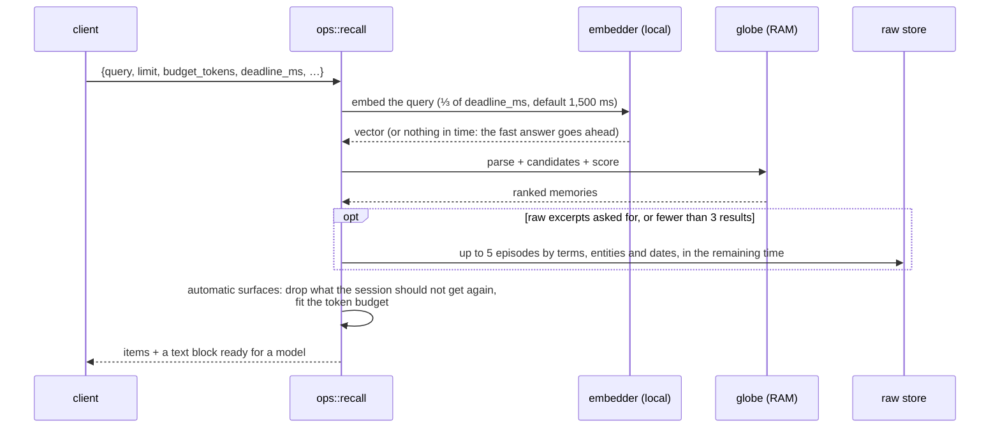
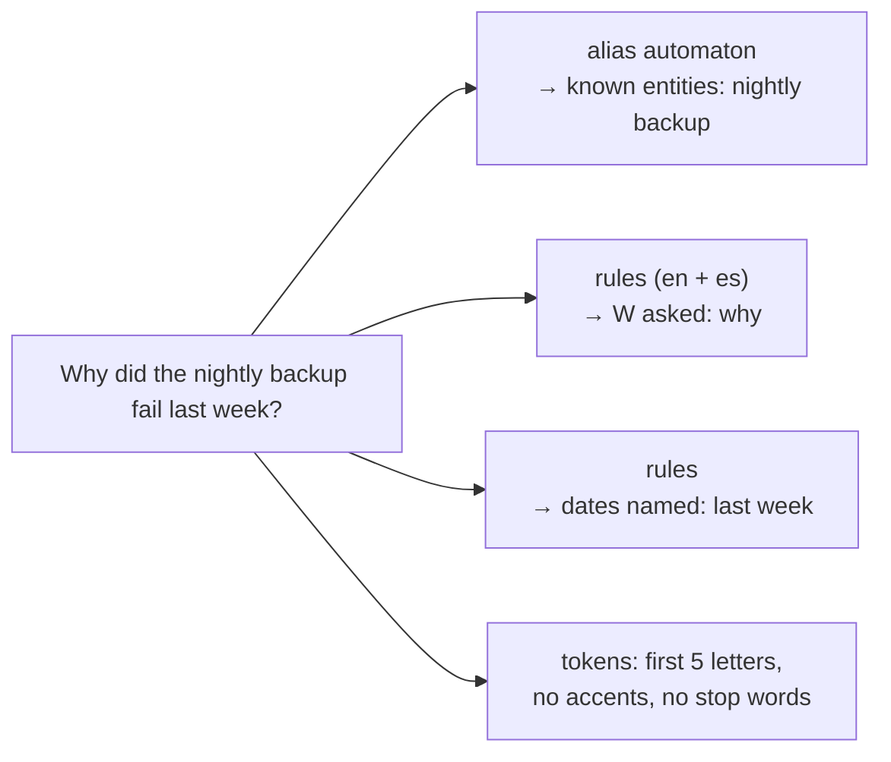
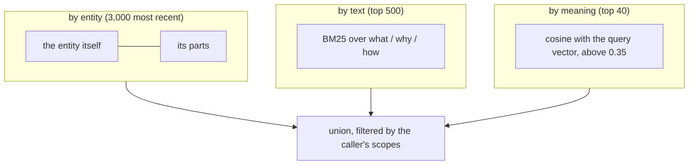

# Recall

Answering a question needs no model call: the in-memory globe, one local embedding and, when
results are few, the raw store.

Typical latency: **35–50 ms**, query embedding included.

## Understanding the question, without a model

A client can also pass `w` and up to 32 entity ids.

## Candidates

## Score

Every candidate gets a deterministic score:

| Term | Points |
|---|---|
| entity in the question | +3 the entity · +2 one of its parts · +1 something that contains it (+0.5 if the link answers the W asked: who, where) |
| text (BM25 *b*) | +3·b/(b+2) |
| meaning (cosine *c*) | +3·c |
| dates in the question overlap the memory | +2.5 (−2 if it has a date outside) |
| it answers the W asked (has a why for "why") | +1.2 |
| live (no end date) | +0.6 |
| has an end date, and the question neither asks why nor names dates | −6 |
| recency | +0.5·e^(−age/30 days) |
| confidence ([the judge](judge.md)) | +0.4·confidence |

Two entities with the same name in the question (a service and its repo, both "billing") count
once. The −6 keeps a memory that is no longer true behind anything live that also answers.

## Language

Memories are in English; questions come in any language. Entities and meaning bridge the gap.
Measured with the same 12 questions in both languages:

| Asked in | 1st place | Top 3 |
|---|---|---|
| English | 9/12 | 11/12 |
| Spanish | 8/12 | 10/12 |

## What automatic injection skips

The automatic surfaces (`session_start`, `prompt`) leave out:

| Skipped | Needs |
|---|---|
| a memory or entity already injected into the session since its last reset (start, `/clear`, compaction) | `session` |
| a memory distilled only from the session's own episodes since that reset: the model still has them | `session` and `thread` |
| a memory that is no longer true | – |
| a saved copy of outside content (`keep`): a third party wrote that text | – |
| a memory muted for this person ([cost and value](value.md)) | – |
| everything, for a `<task-notification>` prompt: it is not a question | – |
| everything, once the session's injections since its last reset reach `MNEMO_SESSION_BUDGET_TOKENS` (4,000) | `session` |

Each block is cut to `budget_tokens` (800, 50–20,000). A block sent with `persists: false`
(rebuilt every turn) is neither remembered as seen nor counted against the session budget. An
explicit `recall` skips none of the above.

The text block cites each memory as `[m:<id>]`, so an agent can open the source with
`recall_episode`.
