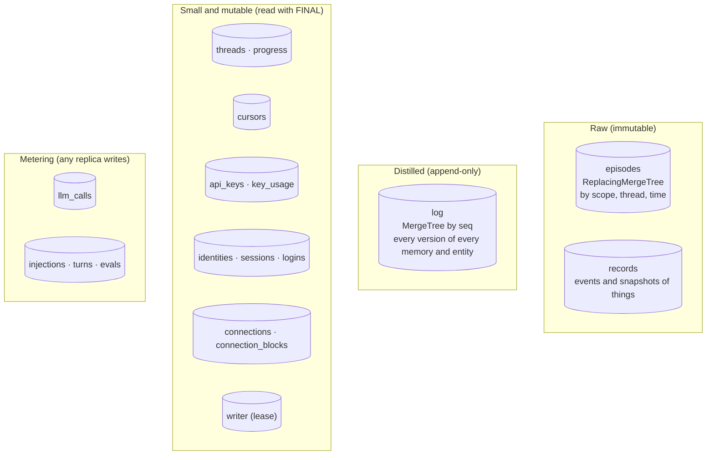
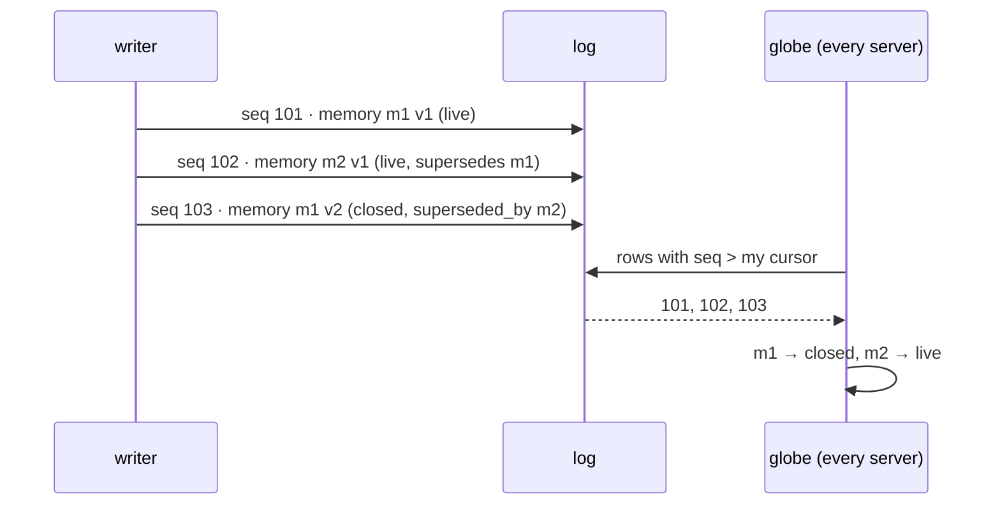
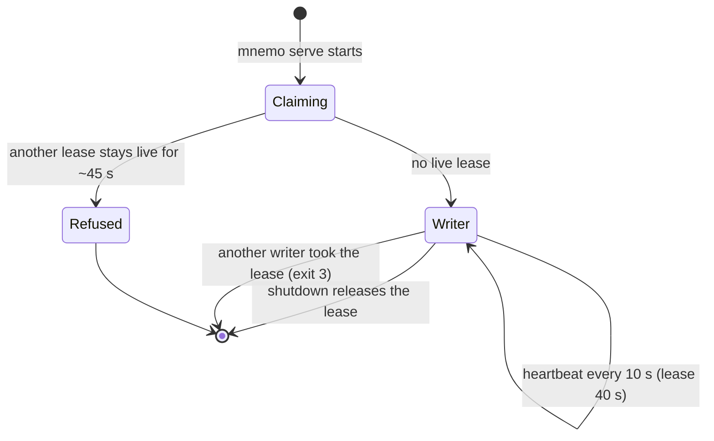
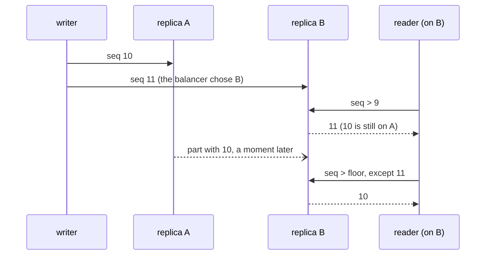

<!--
SPDX-FileCopyrightText: 2026 Mario Campos <https://github.com/mariojcr>
SPDX-License-Identifier: Apache-2.0
-->

# Storage

ClickHouse is the only store; you provide it (`MNEMO_CH_URL`, mnemo starts none). At every start
mnemo creates whatever is missing: the database (unless `MNEMO_CH_REPLICATED=1`) and its tables. It
talks to ClickHouse over HTTP with typed parameters (`{x:String}`): no client string ever enters the
SQL.



## The append-only log

Every change to a memory or an entity is a **new row** with the full version and a sequence
number. The current state is the last row of each id; older rows are history.



Nothing is updated in place, so history comes for free and a replica never sees a half-applied
change.

Every server reads the log into its globe once a second. On a single node the writer skips the
read while its own `seq` has not moved, since every write goes through it, and reads anyway once a
minute in case the log was changed by hand; replicas cannot know, so they always read.

## Tables

| Table | Engine | Holds |
|---|---|---|
| `episodes` | ReplacingMergeTree(revision) | raw episodes; text compressed (ZSTD); normalized text for stem search |
| `log` | MergeTree by `seq` | every version of memories and entities, with the embedding |
| `records` | ReplacingMergeTree | events (open, close, point) and snapshots of things with a stable key |
| `threads`, `progress` | ReplacingMergeTree | last activity per thread, how far distillation got |
| `cursors` | ReplacingMergeTree(value) | how far a source has sent; the embedding model fingerprint |
| `api_keys`, `key_usage` | ReplacingMergeTree | keys (only their sha256) and their last use |
| `identities` | ReplacingMergeTree | subject, email and name of people who signed in |
| `sessions`, `logins` | ReplacingMergeTree | web sessions (cookie id hashed) and in-flight logins |
| `connections`, `connection_blocks` | ReplacingMergeTree | which apps each person uses, and which are disconnected |
| `writer` | ReplacingMergeTree | the single writer's lease and heartbeat |
| `llm_calls`, `injections`, `turns`, `evals` | MergeTree | cost and value metering |

`connection_blocks` is separate from `connections` so that a late activity write can never undo a
block.

## One writer



The writer hands out `seq`, and does alone what would otherwise need a transaction: check that a
judgement is not stale, then write. A write plan carries the `seq` it was judged at; if a live
memory in the same scope about any of its entities was written since, the write is refused and the
pass refreshes and judges again, up to three attempts.

## Replicated ClickHouse

mnemo also runs on a replicated ClickHouse: several replicas of one shard, Keeper, and usually a
load balancer in front. Two things differ from a single node:

- **ClickHouse does not convert engines.** A `Replicated` database replicates DDL but creates a
  `MergeTree` table as a plain `MergeTree`, whose rows stay on the replica that received each
  insert. In a `Replicated` database mnemo creates every table as `Replicated*MergeTree` without
  arguments, and refuses to start if it finds a plain one there.
- **Two requests can reach two replicas**, and each replica fetches the other's parts at its own
  pace. Row 11 can be visible before row 10.



### Setting it up

1. On the server: `default_replica_path` and `default_replica_name` (for example
   `/clickhouse/tables/{uuid}/{shard}` and `{replica}`), so a table needs no Keeper path of its own.
   `tests/replicated/replica.xml` is a working example.
2. On **every** replica (it only binds the replica where it runs):

   ```sql
   CREATE DATABASE mnemo ENGINE = Replicated('/clickhouse/databases/mnemo', '{shard}', '{replica}');
   ```

3. A user that can create, alter, write, read and delete in that database, on every replica:
   `GRANT CREATE TABLE, DROP TABLE, ALTER, INSERT, SELECT ON mnemo.*` (lightweight `DELETE` is an
   `ALTER DELETE`). It also reads `system.databases`, `system.tables`, `system.replicas` and
   `system.replication_queue`.
4. `MNEMO_CH_REPLICATED=1`. mnemo detects a `Replicated` database on its own; the variable makes it
   refuse to start when the database is missing or is not `Replicated`, instead of creating a plain
   one that would only exist on the replica that answered.
5. `MNEMO_CH_URL` can point at the load balancer.

### What mnemo does differently

| Problem | What mnemo does |
|---|---|
| A replica that is down holds back DDL: every statement, even an `IF NOT EXISTS` that changes nothing, waits minutes for it | DDL does not wait for other replicas (`distributed_ddl_task_timeout=0`). This replica applies it now; the others take it from the database's DDL queue when they come back |
| A new writer reads `max(seq)` from a replica that lacks the previous writer's last rows, and would hand out the same `seq` again | The writer starts its sequence above the clock in microseconds. No writer writes a row per microsecond |
| An insert fails without the writer knowing it got in, and the next write reuses its `seq` | The sequence moves on even when an insert fails (single node too). A gap is harmless; two rows with one `seq` are not |
| The writer rebuilds a memory (close it, add a source) from an old version on a replica that lacks its last write, and undoes it | The writer remembers what it wrote in the last 15 minutes and builds on whichever version is newer, its own or the stored one. Its own rows also count for the stale check and go into its globe right away |
| A reader reads `seq > cursor` and skips a row that shows up late | Readers read again from a floor: their cursor as it was 15 minutes ago, skipping what they already have (sent as `seq` ranges, so the request grows with the gaps, not the rows). The globe applies a row only if it is newer than the version it holds of that id |
| A new writer claims the lease from a replica that has not seen the live writer's last heartbeat | The lease is read together with that replica's state, in one query. With parts of `log` or `writer` still to fetch, or Keeper unreachable, no lease is taken from it |
| Deleting a person waits for every replica and, with one down, stops halfway, before writing the tombstones | Deletes wait only for the replica that ran them (`lightweight_deletes_sync=1`); the mutation reaches the others through their queue |

On a replicated ClickHouse the writer reads the log every second like the replicas: a write may not
have reached the replica that answers yet.

**Insert deduplication** stays on: a `ReplicatedMergeTree` drops a block identical to a recent one.
Log rows carry a unique `seq`; the small tables are versioned, so an identical block is the same
state; a metering row identical in every column is improbable, and losing one would only
undercount.

### Limits

- A row that takes longer than the window (15 minutes) to become visible is not seen by a process
  that was already running, until it restarts. That only happens when a replica holding rows that
  never reached the other one stays down that long.
- A key or a web session is read by a later request right after it was written. Through a balancer
  without affinity, that request can land on a replica the row has not reached (milliseconds), and a
  sign-in bounces once. Session affinity on the balancer (by client IP) avoids it.
- A writer cannot start while the replica it reaches has `log` or `writer` parts it cannot fetch
  (the replica that holds them is down). That is on purpose: it could not see the last rows.

## Deleting a person

`DELETE /v1/owners/{id}` (the person, an admin or a service) is the only true deletion; everything
else closes. It revokes the person's keys and deletes their episodes, every version of their
memories and entities (replaced by tombstones so replicas drop them), threads, sessions,
identities, connections, blocks and metering rows.

## Testing the contract

`storage/conformance.rs` is the contract. It runs against the in-memory double (`Mem`) and against
a real ClickHouse at `MNEMO_TEST_CH_URL` (each test in its own database, dropped afterwards).
`make test` starts a throwaway ClickHouse for it. Without that variable the ClickHouse cases fail
rather than skip; `MNEMO_TEST_CH_URL=skip` skips them.

`make test-replicated` starts two replicas and a Keeper (`tests/replicated/`) and runs the same
contract on a `Replicated` database, plus the cases that only happen between replicas: a row seen
before the previous one, a writer building on its own last version, sequence numbers after a writer
change, the lease from a lagging replica. Those hold a replica back with `SYSTEM STOP FETCHES`. It
is slow, so it is not part of `make test`.
