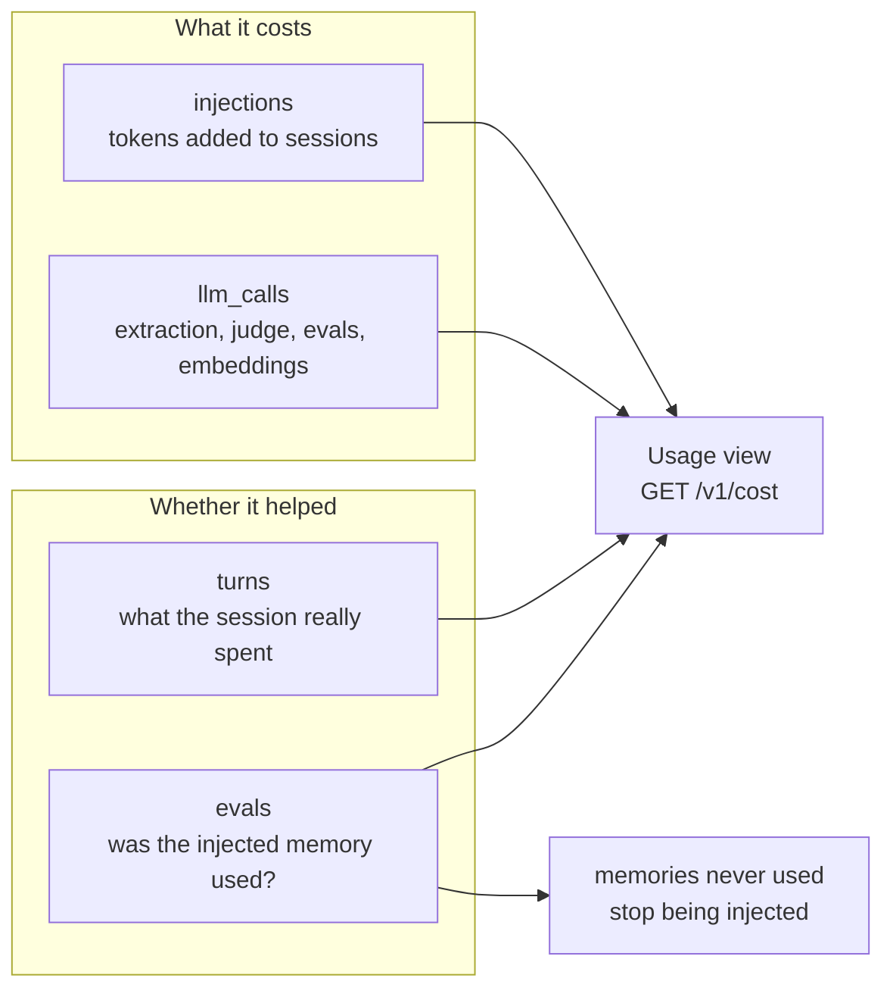
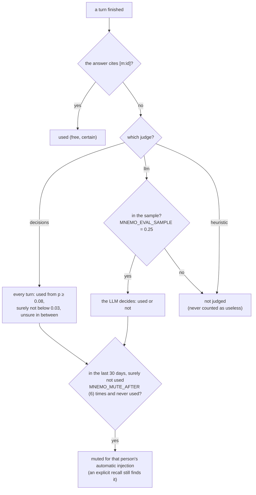

# Cost and value

Memory that costs more than it helps is not worth having. mnemo measures both sides and acts on
them.

## Was it used?

When a client reports a finished turn and its answer (`POST /v1/turns`), each memory injected
since the previous turn, up to the moment the report arrives, is judged once. The window closes on
arrival and the judging runs later, so a client that starts its next turn at once does not have
that turn's memory judged against the previous answer:

Muting is recomputed every 5 minutes; `MNEMO_MUTE_AFTER=0` turns it off.

The decisions thresholds come from 171 blind-labelled injected memories (9 used). The model ranks
them well (AUC 0.94) but gives low probabilities even to what was used (0.036–0.384), so a cut at
0.5 would mark nothing as used and mute every memory. From 0.08 it catches 5 of the 9, with 7
false positives out of 161: erring towards "used" only delays muting. None of the used ones scored
below 0.03. Verdicts keep their p and are re-read against these thresholds.

What else keeps memory out of a session (repetition, the session budget) is in
[recall](recall.md#what-automatic-injection-skips).

## The report

`GET /v1/cost?days=7` (1–90) and the Usage view cover your own sessions; an admin can see anyone's
or everyone's, as numbers only.

| Section | What it shows |
|---|---|
| `injected` | blocks and tokens added to sessions, by surface; memories skipped as repeated or muted, blocks skipped over budget |
| `sessions` | what the sessions themselves spent, and memory's share of their input |
| `background` | model calls and embeddings by kind (`extract`, `judge`, `eval`, `embed`, …): calls, failures, tokens, time |
| `value` | judged and useful blocks, by method; tokens per useful block |
| `daily` | injected and background tokens, judged and useful blocks, per day |
| `memories` | the 25 most injected memories, how often each was used, and whether it is muted |

The judge can dominate background tokens, because a decisions service evaluates every question
against the whole state; that is why its requests are split and the source is cut to a passage
([the judge](judge.md)). Embeddings run inside mnemo: metered, but no API spend. Measured on
Claude Code sessions, injected memory was under 0.02 % of what those sessions read.

`MNEMO_PRICES=claude-sonnet=3,0.3,3.75,15;…` (dollars per million tokens: input, cache read, cache
write, output; a model matches by exact name or prefix) adds dollars to the report.
